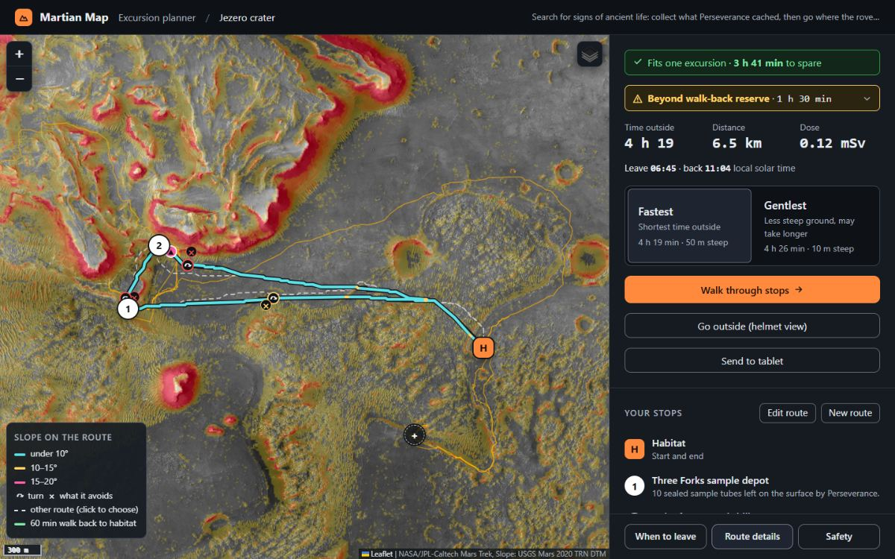
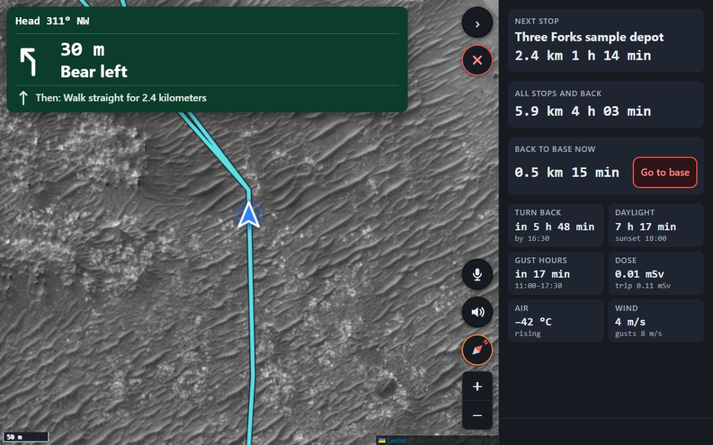
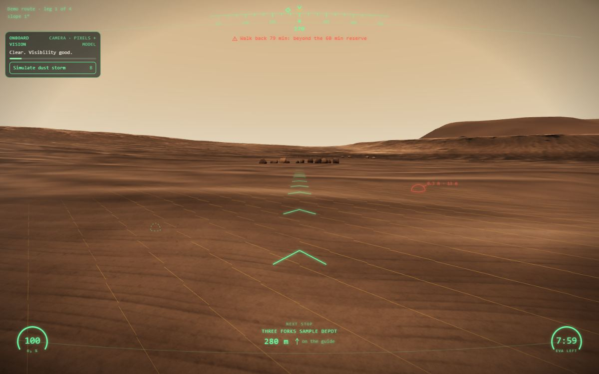

# Martian Map: reviewer guide

You are the crew in a habitat on Mars, planning today's walk outside. Martian Map helps you **plan** the walk, **follow** it on a tablet and **see** the ground through your helmet. It covers one small area: Jezero crater, where Perseverance is exploring. The science goal is to look for signs of ancient life.

**Try it:** https://martian-map-nasa.vercel.app (laptop, Chrome, sound on). Takes about 10 minutes.

## How it works

- **Safe route:** orbit data gives the height of the ground every metre, so the route avoids slopes too steep for a spacesuit.
- **See it first:** every stop shows a real photo Perseverance took nearby.
- **Stay safe:** Perseverance weather data picks when to leave, and the app always knows how long the walk home takes.

## 1. Plan the walk (habitat screen)

1. Open the app, keep **On foot**, click **Next**.
2. Tick **Three Forks sample depot** and **Delta front**. The route appears.
3. Click **Next**, then **See the plan**: time, distance, radiation dose, Fastest or Gentlest route.
4. Click **Walk through stops** to see each stop's rover photo and task.

## 2. Walk it (tablet)

1. Open https://martian-map-nasa.vercel.app/nav?demo=1 (same route, 60× speed). You can also click **Send to tablet** in the planner.
2. Tap **Start navigation**. The voice announces every turn.
3. Tap **Dust storm** in the SIMULATION bar, then **Go to base**.

## 3. Look through the helmet

1. In the planner, click **Go outside (helmet view)**.
2. Hold **W** to walk and drag the mouse to look. Follow the green arrows. Rocks are outlined as the helmet's cameras find them.
3. Press **V** to show the camera's view, **R** to run it on a real rover photo, and **Esc** to go back inside.

## Judging criteria

| Criterion | Where to see it |
|---|---|
| Science goal and site | Signs of ancient life at Jezero; each stop says why it matters |
| 3+ data types | Orbit photos, terrain slope, heat (THEMIS), minerals (CRISM): layers button on the map |
| Astronaut safety | Radiation dose, gusts, daylight, walk home, dust storm alert |
| Route around obstacles | Avoids steep slopes; the helmet steers around rocks |
| Ground-level imagery | Rover photo on every stop, real photo test in the helmet |
| Form factor | Habitat screen, tablet and helmet |

## Links

- Live app: https://martian-map-nasa.vercel.app
- Code: https://github.com/danyarwx/martian-map
- Data: NASA HiRISE, CTX, THEMIS, CRISM, Perseverance photos and MEDA weather, Curiosity RAD, USGS elevation models. Details in [public/data/SOURCES.md](public/data/SOURCES.md).
